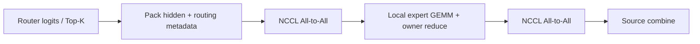

<h1 align="center">MoEFlow</h1>

<p align="center">
  <a href="https://github.com/algebra-MCX/MoEFlow/actions/workflows/ci.yml"></a>  <br>
  <a href="README.md">简体中文</a> · English
</p>

<p align="center">
  
</p>

<p align="center"><b>A compute-communication fused expert-parallel backend for MoE inference in vLLM</b></p>

- **What**: a vLLM 0.32.0 plugin that provides the EP execution backend for **GLM-5.3-Flash** (a ~**321B**-parameter MoE, ~18B activated per token). It does not modify the vLLM installation or take over model loading.
- **How**: Triton kernels fuse dispatch pack, expert input preparation and combine; the whole path needs only two NCCL All-to-All calls.
- **Properties**: no D2H synchronization, CUDA Graph capturable.
- **Target**: low-batch decode on NVIDIA B200, shortening the critical path of the MoE layer.



## Features

- **Plugin integration with vLLM**: registered through `vllm.general_plugins`; wraps `FusedMoEFactory` and injects `MoEFlowRunner`. The vLLM installation is untouched and model loading stays with vLLM.
- **Fixed-capacity path with two All-to-Alls**: hidden states, K expert ids, K FP32 routing weights and a valid flag are bit-packed into one row, sent in one dispatch and returned in one All-to-All. No counts exchange, no D2H readback, no stream sync, so the whole path is CUDA Graph capturable.
- **Triton kernel stack**: on-device expert metadata and tile scheduling, Grouped GEMM (SwiGLU expert MLP), fused dispatch pack, fused expert input preparation, and a deterministic combine (FP32 accumulation in slot order per owner, merged in ascending EP rank).
- **Performance engineering gated on correctness**: an independent per-token, per-expert PyTorch reference; bitwise-exact dispatch/restore; every performance point is preceded by an all-rank reference check and a Graph replay check.
- **Reproducible measurement**: interleaved A/B pairing, slowest rank per sample, 95% confidence intervals; every result carries a JSON with git SHA, environment, seed and command.

## Environment

| | |
|---|---|
| Model | GLM-5.3-Flash: ~321B total parameters, ~18B activated per token; hidden 4096, 288 routed experts + 1 shared expert, top-8, 42 MoE layers (FP8 weights) |
| Hardware | NVIDIA B200 (sm_100), NVLink-5 |
| Software | vLLM 0.32.0 · torch 2.13 + CUDA 13 · Triton 3.7.1 · NCCL 2.29.7 |
| Parallelism | attention TP=1, DP=N, EP=N (EP=4 verified) |

## Core modules

| Module | Role |
|---|---|
| `kernels/metadata.py` | One Triton kernel builds expert offsets and a bounded tile map on the GPU, replacing `bincount().tolist()` and host-side metadata construction, which removes the D2H/H2D copies and stream sync on that path |
| `kernels/grouped_gemm.py` | Triton BF16 Grouped GEMM with on-device tile scheduling; gathers A rows through the expert-major index inside the kernel; SwiGLU expert MLP |
| `kernels/dispatch_pack.py` | Fused dispatch pack: writes hidden states and routing metadata into the send buffer in one pass |
| `kernels/expert_prepare.py` | Fused expert input preparation: unpacks received rows into contiguous hidden states, global expert ids and FP32 weights |
| `kernels/reduce.py` | Deterministic combine: FP32 accumulation in slot order within an owner, FP32 merge in ascending EP rank; includes a BF16 Ring combine variant |
| `fixed.py` | `FixedEPLayer`: fixed-capacity EP layer with static shapes and fixed row positions (token t sent to rank d always occupies `send[d, t]`) |
| `integrations/vllm_runner.py` | `MoEFlowRunner`: registered via `vllm.general_plugins`, injected by wrapping `FusedMoEFactory`, serving as the EP backend of GLM MoE layers |
| `reference.py` | Independent naive per-token, per-expert PyTorch reference that shares no indexing logic with the kernels under test |

The cost is explicit too: static shapes mean every token is sent to every rank, so dispatch moves EP × C rows instead of the actual number of hits. This padding overhead is measured by a dedicated benchmark.

## Performance

Setup: 4× B200 (NVLink-5), EP=4, GLM-5.3-Flash layer 3 (BF16), uniform routing. Timing covers the complete routed MoE layer (router logits to weighted merge) under CUDA Graph replay, taking the slowest of the 4 ranks per sample, with 20 interleaved A/B repetitions; a gain counts only if the 95% confidence interval of the paired difference excludes zero. Every point is preceded by a check against the independent reference.

**Fusion gains (versus MoEFlow's own unfused Torch Ring path, µs)**

| Tokens per rank | Before fusion | After three fusions | Reduction |
|---:|---:|---:|---:|
| 1 | 249.7 | 144.2 | 42.3% |
| 8 | 574.9 | 461.7 | 19.7% |
| 128 | 873.9 | 740.8 | 15.2% |

All 8 sizes (T = 1, 2, 4, 8, 16, 32, 64, 128) meet the gain criterion, with reductions of 15.1%–42.3%.

**Versus native vLLM all-gather / reduce-scatter (same router, same expert GEMM, µs)**

| Tokens per rank | vLLM native | MoEFlow | Change |
|---:|---:|---:|---:|
| 1 | 140.9 | 146.5 | +3.9% |
| 8 | 451.3 | 464.9 | +3.0% |
| 128 | 742.3 | 752.7 | +1.4% |

After fusion MoEFlow is close to native, but it is still 1.4%–4.7% slower at all 8 sizes and no point meets the gain criterion. The two tables come from two independent runs and must not be subtracted from each other.
End to end (full FP8 model, 1024 input / 1024 output tokens, concurrency 4), the two runs point in opposite directions and the native arm's own TPOT differs by 11.6% between runs, more than the gap between arms, so the data **do not establish a stable end-to-end speedup**.

Not done yet: EP=8, concurrent correctness, long-prefill performance, and an end-to-end comparison against DeepEP HT. The exact-score check at 8192 tokens still fails.

## Quick start

```bash
git clone https://github.com/algebra-MCX/MoEFlow.git && cd MoEFlow && scripts/quickstart.sh
```

One command creates `.venv`, installs the pinned vLLM 0.32.0 and MoEFlow, and runs the CPU regression (reference, routing, dispatch/restore, EP simulator). It needs [uv](https://docs.astral.sh/uv/) and Python 3.12, and no GPU.
Inside a Slurm allocation, set `MOEFLOW_JOBID=<alloc>` and run the same command to run the full suite (single GPU, multi-GPU, vLLM smoke).

The distribution and vLLM plugin are named `moeflow`; the `MOEFLOW_*` switches are stable.

## Code structure

| Path | Role |
|---|---|
| `moeflow/fixed.py` | **Main path**: wires the whole flow together, one All-to-All each for dispatch and return |
| `moeflow/kernels/` | Triton kernels: pack, input preparation, Grouped GEMM, metadata, reduce/combine |
| `moeflow/integrations/` | vLLM integration: plugin registration, `MoEFlowRunner` |
| `moeflow/reference.py` | Independent per-token, per-expert reference that every optimization is checked against |
| `moeflow/ep_moe.py` `dispatch.py` `comm.py` `experts.py` | Naive path (variable-split All-to-All), kept as the comparison baseline |
| `moeflow/router.py` `config.py` | Routing and model configuration |
| `tests/` | pytest; `tests/multigpu/` holds the torchrun multi-GPU checks |
| `scripts/` | Benchmarks, A/B comparisons, end-to-end runs and Slurm jobs; `scripts/bench/` has the timing and statistics helpers |

Suggested reading order: `moeflow/hand_example.py` (a small worked example) → `reference.py` → `fixed.py` → `kernels/` → `integrations/vllm_runner.py`.

## Tests

```bash
scripts/run_all_tests.sh                                 # everything (needs MOEFLOW_JOBID for GPUs)
.venv/bin/python -m pytest -m "not gpu and not multigpu and not vllm"   # CPU only
srun --jobid=$JOB --overlap -n1 --gres=gpu:1 .venv/bin/python -m pytest   # + single GPU
MOEFLOW_JOBID=$JOB scripts/run_multigpu_check.sh 4 --iters 1000 --out results/ep4.json
MOEFLOW_JOBID=$JOB scripts/smoke_vllm.sh checkpoints/GLM-5.3-Flash-4L 2 results/smoke_dp2
```

Real-weight layer tests read the checkpoint directory from `MOEFLOW_MODEL_PATH` (default `checkpoints/GLM-5.3-Flash`). GPU jobs run inside a Slurm allocation (`salloc --no-shell`, then `srun --jobid --overlap`).

## Contributing and license

See [CONTRIBUTING.md](CONTRIBUTING.md) for conventions. Code adapted from vLLM / DeepEP is credited in [PROVENANCE.md](PROVENANCE.md).
Licensed under [Apache License 2.0](LICENSE).
