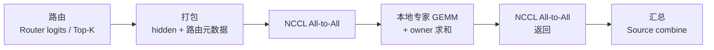

<h1 align="center">MoEFlow</h1>

<p align="center">
  <a href="https://github.com/algebra-MCX/MoEFlow/actions/workflows/ci.yml"></a>  <br>
  简体中文 · <a href="README.en.md">English</a>
</p>

<p align="center">
  
</p>

<p align="center"><b>面向 vLLM 的 MoE Expert Parallel 通算融合通信后端</b></p>

- **是什么**：vLLM 0.32.0 插件，为 **GLM-5.3-Flash**（约 **321B** 参数的 MoE 大模型，每 token 激活约 18B）提供 EP 执行后端；不修改 vLLM 安装目录，不接管模型加载
- **怎么做**：用 Triton 融合 dispatch pack、expert 输入准备与 combine，整条路径只需两次 NCCL All-to-All
- **有什么特点**：无 D2H 同步，可被 CUDA Graph 捕获
- **为谁优化**：NVIDIA B200 上的低 batch decode，缩短 MoE 层关键路径



## 特性

- **插件式接入 vLLM**：通过 `vllm.general_plugins` 注册，包装 `FusedMoEFactory` 并注入 `MoEFlowRunner`，不修改 vLLM 安装目录，不接管模型加载。
- **两次 All-to-All 的固定容量路径**：hidden、K 个 expert id、K 个 FP32 路由权重与 valid 标志 bit-pack 成同一行，一次 dispatch、一次 return；无 counts 交换，无 D2H 回读，无流同步，整条路径可被 CUDA Graph 捕获。
- **Triton kernel 栈**：设备端 expert metadata 与 tile 调度、Grouped GEMM（SwiGLU 专家 MLP）、fused dispatch pack、fused expert input preparation、确定性 Combine（owner 内按 slot 序 FP32 累加，按 EP rank 升序合并）。
- **以正确性为前提的性能工程**：独立的逐 token、逐 expert PyTorch Reference；dispatch/restore 逐位一致；每个性能点计时前先过全 rank 对拍与 Graph replay 检查。
- **可复现的测量**：A/B 交替配对、取最慢 rank、95% 置信区间判定；每个结果都带 git SHA、环境、种子和命令的原始 JSON。

## 环境

| | |
|---|---|
| 模型 | GLM-5.3-Flash：约 321B 总参数、每 token 激活约 18B；hidden 4096，288 routed expert + 1 shared expert，top-8，42 层 MoE（FP8 权重） |
| 硬件 | NVIDIA B200（sm_100），NVLink-5 |
| 软件栈 | vLLM 0.32.0 · torch 2.13 + CUDA 13 · Triton 3.7.1 · NCCL 2.29.7 |
| 并行 | attention TP=1，DP=N，EP=N（已验证 EP=4） |

## 核心模块

| 模块 | 做了什么 |
|---|---|
| `kernels/metadata.py` | 单个 Triton kernel 在 GPU 内构造 expert offsets 与有界 tile map，替代 `bincount().tolist()` 和 Host 侧多段 metadata 构造，去掉该路径的 D2H/H2D 与流同步 |
| `kernels/grouped_gemm.py` | Triton BF16 Grouped GEMM：设备端 tile 调度，kernel 内按 expert-major 索引 gather A 行，SwiGLU 专家 MLP |
| `kernels/dispatch_pack.py` | fused dispatch pack：把 hidden 与路由元数据一次写入发送缓冲 |
| `kernels/expert_prepare.py` | fused expert input preparation：把接收到的行解包成连续的 hidden、全局 expert ID 与 FP32 权重 |
| `kernels/reduce.py` | owner 内按 slot 序 FP32 累加、按 EP rank 升序 FP32 合并的确定性 Combine；含 BF16 Ring combine 变体 |
| `fixed.py` | `FixedEPLayer`：静态形状、固定行位置（token t 发往 rank d 永远占 `send[d, t]`）的固定容量 EP 层 |
| `integrations/vllm_runner.py` | `MoEFlowRunner`：通过 `vllm.general_plugins` 注册、包装 `FusedMoEFactory` 注入，作为 GLM MoE 层的 EP 后端，不改 vLLM 安装目录 |
| `reference.py` | 独立的逐 token、逐 expert 朴素 PyTorch Reference，不复用任何被测 kernel 的索引逻辑 |

代价同样明确：静态形状意味着每个 token 都会发往每个 rank，dispatch 搬运 EP × C 行而不是实际命中数；这部分填充开销在专门的基准里测量。

## 性能

测量条件：4× B200（NVLink-5）、EP=4、GLM-5.3-Flash 第 3 层（BF16）、均匀路由。计时范围是完整 routed MoE 层（router logits 到加权合并），
CUDA Graph replay，每个样本取 4 个 rank 中最慢者，A/B 交替配对 20 次，以配对差值的 95% 置信区间判定收益。每个点计时前先过独立 Reference 对拍。

**融合收益（相对 MoEFlow 自己未融合的 Torch Ring 路径，µs）**

| 每 rank token 数 | 融合前 | 三项融合后 | 降低 |
|---:|---:|---:|---:|
| 1 | 249.7 | 144.2 | 42.3% |
| 8 | 574.9 | 461.7 | 19.7% |
| 128 | 873.9 | 740.8 | 15.2% |

T=1、2、4、8、16、32、64、128 共 8 个规模全部满足收益判据，降低 15.1%–42.3%。

**与 vLLM 原生 all-gather / reduce-scatter 对比（相同 router、相同 expert GEMM，µs）**

| 每 rank token 数 | vLLM 原生 | MoEFlow | 变化 |
|---:|---:|---:|---:|
| 1 | 140.9 | 146.5 | +3.9% |
| 8 | 451.3 | 464.9 | +3.0% |
| 128 | 742.3 | 752.7 | +1.4% |

融合后的 MoEFlow 已逼近原生，但 8 个规模上仍慢 1.4%–4.7%，没有一个点满足收益判据；两张表来自两轮独立测量，不能直接相减。
端到端（完整 FP8 模型、1024 输入 / 1024 输出、并发 4）两轮测量的方向相反，原生臂自身的 TPOT 两轮相差 11.6%，大于两臂差距，因此**不能证明端到端有稳定加速**。

尚未完成：EP=8、并发正确性、长 prefill 性能，以及与 DeepEP HT 的端到端对比；8192 token 的精确分数门禁仍未通过。

## 快速开始

```bash
git clone https://github.com/algebra-MCX/MoEFlow.git && cd MoEFlow && scripts/quickstart.sh
```

一条命令完成：创建 `.venv`、安装固定版本的 vLLM 0.32.0 与 MoEFlow、运行 CPU 回归（Reference、路由、dispatch/restore、EP 模拟器）。需要 [uv](https://docs.astral.sh/uv/) 和 Python 3.12，不需要 GPU。
在 Slurm 分配内设置 `MOEFLOW_JOBID=<alloc>` 再运行同一条命令，会改为跑完整套件（单卡、多卡、vLLM smoke）。

发行包和 vLLM 插件名为 `moeflow`，`MOEFLOW_*` 开关保持稳定。

## 代码结构

| 位置 | 作用 |
|---|---|
| `moeflow/fixed.py` | **主路径**：把整条流程串起来，dispatch 与 return 各一次 All-to-All |
| `moeflow/kernels/` | Triton kernel：打包、输入准备、Grouped GEMM、metadata、求和/汇总 |
| `moeflow/integrations/` | vLLM 接入：插件注册、`MoEFlowRunner` |
| `moeflow/reference.py` | 逐 token、逐 expert 的独立 Reference，所有优化都以它为准 |
| `moeflow/ep_moe.py` `dispatch.py` `comm.py` `experts.py` | 朴素路径（变长 All-to-All），作为对照基线 |
| `moeflow/router.py` `config.py` | 路由与模型配置 |
| `tests/` | pytest；`tests/multigpu/` 是 torchrun 多卡检查 |
| `scripts/` | 基准、A/B 对比、端到端与 Slurm 作业，`scripts/bench/` 是计时与统计工具 |

建议阅读顺序：`moeflow/hand_example.py`（手工小示例）→ `reference.py` → `fixed.py` → `kernels/` → `integrations/vllm_runner.py`。

## 测试

```bash
scripts/run_all_tests.sh                                 # everything (needs MOEFLOW_JOBID for GPUs)
.venv/bin/python -m pytest -m "not gpu and not multigpu and not vllm"   # CPU only
srun --jobid=$JOB --overlap -n1 --gres=gpu:1 .venv/bin/python -m pytest   # + single GPU
MOEFLOW_JOBID=$JOB scripts/run_multigpu_check.sh 4 --iters 1000 --out results/ep4.json
MOEFLOW_JOBID=$JOB scripts/smoke_vllm.sh checkpoints/GLM-5.3-Flash-4L 2 results/smoke_dp2
```

真实权重层测试通过 `MOEFLOW_MODEL_PATH` 指定 checkpoint 目录，默认 `checkpoints/GLM-5.3-Flash`。GPU 任务在 Slurm 分配中运行（先 `salloc --no-shell`，再 `srun --jobid --overlap`）。

## 贡献与许可

贡献约定见 [CONTRIBUTING.md](CONTRIBUTING.md)。改编自 vLLM / DeepEP 的代码来源见 [PROVENANCE.md](PROVENANCE.md)。
本项目采用 [Apache License 2.0](LICENSE)。
